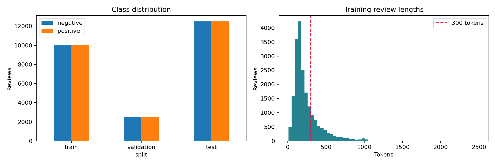
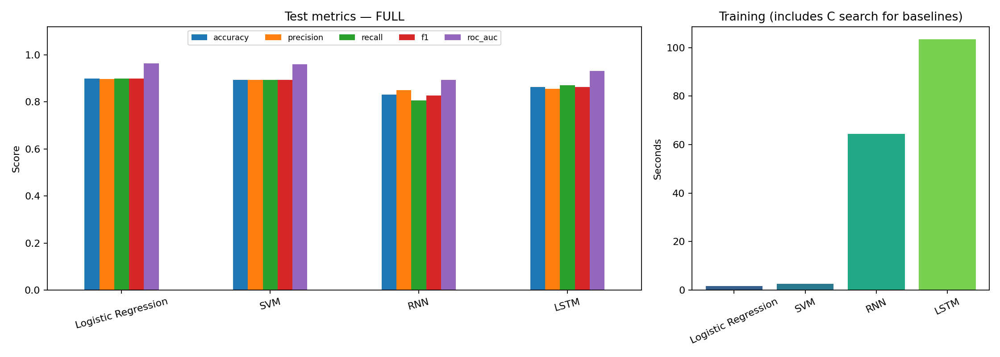
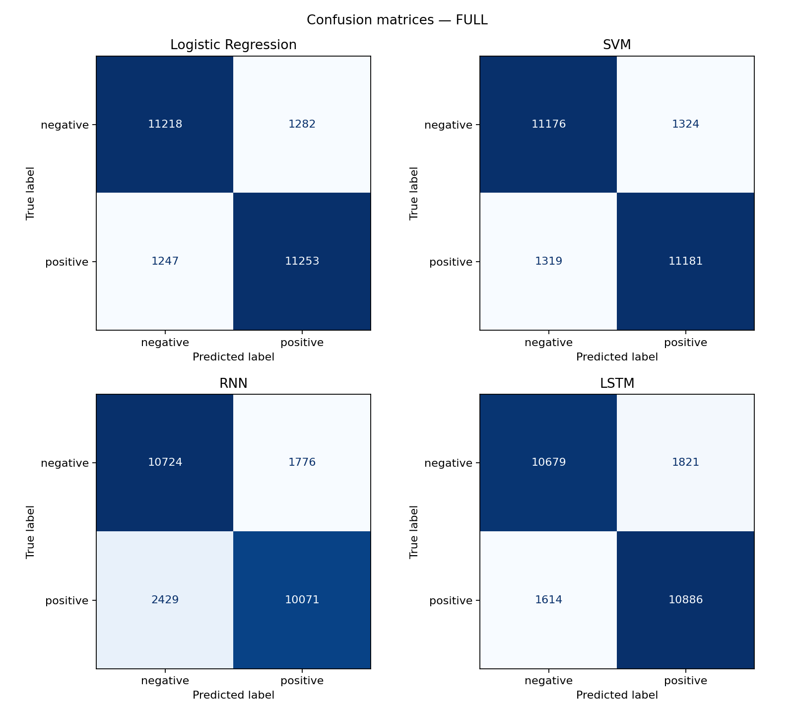
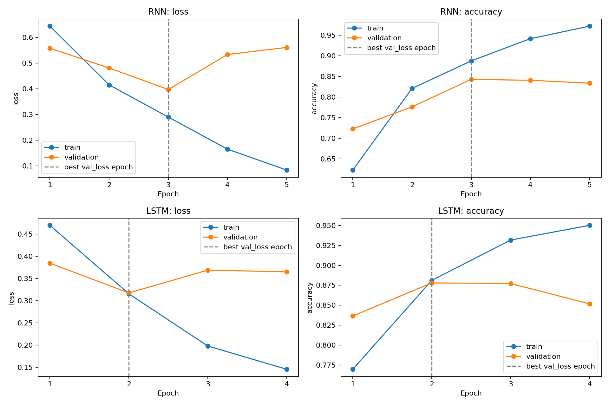

# Phân tích cảm xúc IMDB bằng RNN và LSTM

> **Đã chạy FULL tại máy local ngày 27/10/2026, sử dụng CPU.** Huấn luyện trên 20.000 mẫu, chọn mô hình bằng 5.000 mẫu validation và đánh giá trên 25.000 mẫu test chính thức. Logistic Regression đạt F1 cao nhất trong lần chạy này (0.8990), Accuracy 89.88%.

## 1. Mục tiêu và dữ liệu

Phân loại một đánh giá phim tiếng Anh thành negative (0) hoặc positive (1),
so sánh SimpleRNN, LSTM với hai phương pháp truyền thống Logistic Regression
và SVM tuyến tính. Các mô hình được huấn luyện lại trên cùng cách chia dữ liệu.

IMDB Large Movie Review Dataset gồm 50.000 đánh giá có nhãn, cân bằng hai lớp.
Giữ nguyên 25.000 mẫu test chính thức; tách phân tầng 25.000 mẫu train thành
20.000 train và 5.000 validation với seed 42. Không dùng 50.000 mẫu không nhãn.
Ưu tiên tải bản văn bản gốc Stanford; nếu máy chủ không truy cập được, dùng
bản Parquet từ kho `stanfordnlp/imdb`, giữ hai split train/test có sẵn.
CSV không có thông tin split trong thư mục `archive/` không được dùng để tự
chia lại test. ID trong bản Parquet là ID dòng của nguồn, không phải ID phim.

## 2. Cơ sở lý thuyết

### TF-IDF, Logistic Regression và SVM

TF-IDF kết hợp tần suất từ trong tài liệu với độ hiếm trong tập train.
Với `sublinear_tf=True`, TF của từ xuất hiện được biến đổi thành
$1+\log(tf)$. IDF mặc định có làm trơn:
$\mathrm{idf}(t)=\log((1+N)/(1+df(t)))+1$; vector được chuẩn hóa L2.
Unigram biểu diễn từng từ, bigram biểu diễn cặp như “not good”. Cách biểu diễn
này không mô hình hóa đầy đủ thứ tự câu nhưng thường là baseline mạnh.

Logistic Regression dự đoán $p(y=1|x)=\sigma(w^Tx+b)$, tối ưu log loss với
regularization L2. Linear SVM tìm biên phân tách có margin lớn; `LinearSVC`
dùng squared hinge loss và regularization L2 mặc định. Tham số $C$ điều khiển
mức phạt lỗi: $C$ lớn tương ứng regularization yếu hơn. Điểm `decision_function`
của SVM là khoảng cách có dấu tương đối, **không phải xác suất**.

### RNN

Với embedding $x_t$, RNN cập nhật trạng thái:

$$h_t=\tanh(W_xx_t+W_hh_{t-1}+b_h),\qquad
\hat y=\sigma(w_o^Th_T+b_o).$$

Trạng thái cuối tổng hợp thông tin theo thứ tự từ. Khi lan truyền ngược qua
nhiều bước thời gian, tích nhiều đạo hàm có thể làm gradient tiêu biến hoặc
bùng nổ. RNN vì vậy khó giữ thông tin ở đầu một đánh giá dài. Gradient clipping
giúp kiểm soát gradient bùng nổ, không giải quyết hoàn toàn gradient tiêu biến.

### LSTM

LSTM bổ sung trạng thái ô nhớ $c_t$ và ba cổng:

$$f_t=\sigma(W_f[x_t,h_{t-1}]+b_f),\quad
i_t=\sigma(W_i[x_t,h_{t-1}]+b_i),$$
$$\tilde c_t=\tanh(W_c[x_t,h_{t-1}]+b_c),\quad
c_t=f_t\odot c_{t-1}+i_t\odot\tilde c_t,$$
$$o_t=\sigma(W_o[x_t,h_{t-1}]+b_o),\quad
h_t=o_t\odot\tanh(c_t).$$

Cổng quên chọn thông tin giữ lại, cổng vào chọn thông tin mới, cổng ra điều khiển
trạng thái ẩn. Đường cập nhật cộng của ô nhớ hỗ trợ truyền thông tin xa hơn.
LSTM có nhiều tham số hơn SimpleRNN cùng số units; kết quả thực tế còn phụ thuộc
dữ liệu, regularization và ngân sách huấn luyện, không bảo đảm luôn tốt hơn.

## 3. Thiết kế thí nghiệm

- Làm sạch HTML, giải mã HTML entities, chuyển chữ thường, mở rộng phủ định
  như “isn't” → “is not”, thay dấu câu bằng khoảng trắng. Không bỏ stopword.
- Chỉ `fit` TF-IDF và `adapt` từ vựng trên train. Validation và test chỉ transform.
- Baseline: TF-IDF unigram/bigram, tối đa 20.000 đặc trưng, `min_df=2`,
  `sublinear_tf=True`. Logistic Regression và LinearSVC thử $C\in\{0.1,1,10\}$;
  chọn F1 validation cao nhất, hòa thì chọn C nhỏ hơn. Không refit trên train+val.
- Mạng: Embedding 128 → SimpleRNN/LSTM 64 → Dropout 0,5 → Dense sigmoid.
  Từ vựng chung tối đa 20.000 token (gồm padding/OOV), chuỗi 300 token,
  cắt phần cuối, padding cuối, `mask_zero=True`. Embedding học từ đầu.
- Adam learning rate 0,001, `clipnorm=1.0`, binary cross-entropy, batch 128,
  tối đa 10 epoch. Early stopping theo validation loss, patience 2,
  khôi phục trọng số tốt nhất. Hai mạng đặt lại cùng seed 42 trước khi tạo.
- LSTM dùng tanh/sigmoid, `recurrent_dropout=0`, không unroll, có bias và
  padding cuối để tương thích cuDNN khi GPU/runtime hỗ trợ.
- Dùng Accuracy, Precision, Recall, F1 (positive là lớp 1), ROC-AUC và confusion
  matrix. Ngưỡng dự đoán là 0,5 cho sigmoid/Logistic Regression, 0 cho SVM.
  ROC-AUC dùng xác suất hoặc margin của SVM, không dùng nhãn cứng.
- Chỉ tính kết quả test sau khi chọn C và trọng số mạng bằng validation.
  Theo dõi loss/accuracy train và validation để thảo luận overfitting.

TF-IDF dùng toàn bộ đánh giá, mạng chỉ dùng 300 token đầu. Đây là so sánh các
pipeline thực tế, chưa cô lập riêng ảnh hưởng của kiến trúc. Thời gian fit không
gồm tiền xử lý và đánh giá test cuối cùng; baseline cộng thời gian cả ba giá trị C, mạng cộng
các epoch đã chạy. Thời gian tạo đặc trưng được ghi riêng. Baseline chạy CPU;
mạng dùng GPU khi có. So sánh thời gian phụ thuộc phần cứng, không chứng minh
một thuật toán có độ phức tạp thấp hơn. Một seed chưa đo được độ biến thiên
giữa các lần chạy và không đủ để khẳng định ý nghĩa thống kê.

## 4. Kết quả thực nghiệm

Lần chạy: **FULL**. Nguồn: stanfordnlp/imdb Parquet (official splits). Thời điểm UTC: 2026-10-27T16:22:05.509572+00:00.

### 4.1. Dữ liệu thực tế và tài nguyên

| split | samples | negative | positive | mean_tokens | p95_tokens | truncated_fraction |
| --- | --- | --- | --- | --- | --- | --- |
| train | 20000 | 10000 | 10000 | 237.6261 | 604.0000 | 0.2338 |
| validation | 5000 | 2500 | 2500 | 240.8070 | 626.0500 | 0.2408 |
| test | 25000 | 12500 | 12500 | 232.8593 | 593.0000 | 0.2244 |

CPU: Intel64 Family 6 Model 197 Stepping 2, GenuineIntel; GPU: không có. Baseline: CPU; mạng: CPU. Vocabulary: 20000; TF-IDF: 20000 đặc trưng.

### 4.2. Chọn cấu hình bằng validation

| model | C | validation_f1 | fit_seconds | run_mode |
| --- | --- | --- | --- | --- |
| Logistic Regression | 0.1000 | 0.8745 | 0.2716 | full |
| Logistic Regression | 1.0000 | 0.9024 | 0.4463 | full |
| Logistic Regression | 10.0000 | 0.9063 | 0.9484 | full |
| SVM | 0.1000 | 0.9035 | 0.4221 | full |
| SVM | 1.0000 | 0.9071 | 0.7682 | full |
| SVM | 10.0000 | 0.8920 | 1.4226 | full |

| model | C | validation_f1 | train_seconds | selected_fit_seconds | device | epochs_run | best_epoch | best_validation_loss | best_validation_accuracy | parameters |
| --- | --- | --- | --- | --- | --- | --- | --- | --- | --- | --- |
| Logistic Regression | 10.0000 | 0.9063 | 1.6663 | 0.9484 | CPU |  |  |  |  |  |
| SVM | 1.0000 | 0.9071 | 2.6129 | 0.7682 | CPU |  |  |  |  |  |
| RNN |  |  | 64.4301 |  | CPU | 5.0000 | 3.0000 | 0.3970 | 0.8426 | 2572417.0000 |
| LSTM |  |  | 103.4487 |  | CPU | 4.0000 | 2.0000 | 0.3174 | 0.8780 | 2609473.0000 |

### 4.3. So sánh trên cùng tập test

| model | run_mode | test_samples | accuracy | precision | recall | f1 | roc_auc | train_seconds | predict_seconds | device |
| --- | --- | --- | --- | --- | --- | --- | --- | --- | --- | --- |
| Logistic Regression | full | 25000 | 0.8988 | 0.8977 | 0.9002 | 0.8990 | 0.9633 | 1.6663 | 0.0196 | CPU |
| SVM | full | 25000 | 0.8943 | 0.8941 | 0.8945 | 0.8943 | 0.9606 | 2.6129 | 0.0186 | CPU |
| RNN | full | 25000 | 0.8318 | 0.8501 | 0.8057 | 0.8273 | 0.8929 | 64.4301 | 3.9988 | CPU |
| LSTM | full | 25000 | 0.8626 | 0.8567 | 0.8709 | 0.8637 | 0.9326 | 103.4487 | 7.7422 | CPU |

Thời gian tạo đặc trưng (tách khỏi thời gian fit):

TF-IDF fit: 7.232s; vocabulary adapt: 0.821s.

| split | tfidf_transform_seconds | sequence_transform_seconds |
| --- | --- | --- |
| train | 3.2962 | 0.6497 |
| validation | 0.8148 | 0.1664 |
| test | 4.0191 | 0.8136 |

### 4.4. Học theo epoch và overfitting

- RNN: đã chạy 5 epoch, chọn epoch 3; train accuracy − validation accuracy tại epoch chọn = 0.0448.
- LSTM: đã chạy 4 epoch, chọn epoch 2; train accuracy − validation accuracy tại epoch chọn = 0.0031.

Khoảng cách train/validation và xu hướng validation loss là dấu hiệu cần xem xét cùng nhau. Validation loss tăng trong khi train loss giảm có thể gợi ý overfitting.

### 4.5. Phân tích lỗi

| model | length_group | samples | error_rate |
| --- | --- | --- | --- |
| Logistic Regression | <=300 | 19389 | 0.1009 |
| Logistic Regression | >300 | 5611 | 0.1019 |
| SVM | <=300 | 19389 | 0.1058 |
| SVM | >300 | 5611 | 0.1053 |
| RNN | <=300 | 19389 | 0.1508 |
| RNN | >300 | 5611 | 0.2285 |
| LSTM | <=300 | 19389 | 0.1234 |
| LSTM | >300 | 5611 | 0.1859 |

Bảng theo độ dài mô tả tương quan; độ khó nội dung và độ dài cùng thay đổi nên không thể kết luận việc cắt chuỗi là nguyên nhân duy nhất. Các ví dụ sau được chọn tự động từ những dự đoán sai xa ngưỡng nhất. `has_negation` chỉ đánh dấu có not/no/never, không xác định phạm vi phủ định.

**Logistic Regression — test/04118:** nhãn thật 0, dự đoán 1, điểm 0.9982, 61 token, có phủ định: True.

> This is definitely one of the best Kung fu movies in the history of Cinema. The screenplay is really well done (which is not often the case for this type of movies) and you can see that Chuck (in one of his first role)is a great actor. The final fight with the sherif deputy in the bullring is a masterpiece!

**Logistic Regression — test/20621:** nhãn thật 1, dự đoán 0, điểm 0.0020, 219 token, có phủ định: True.

> This was Laurel and Hardy&#x27;s last silent film for Roach Studios. However, since the public had a real thirst for &quot;talkies&quot;, this same short was re-made by the team just a few years later with only a few small plot changes. LAUGHING GRAVY was essentially the same plot except that Stan and Ollie were trying to hide a cute puppy from their grouchy landlord--not a goat like in ANGORA LOVE. This whole goat angle is the worst part of the film. While you could understand the boys wanting to keep a cute 

**Logistic Regression — test/00776:** nhãn thật 0, dự đoán 1, điểm 0.9975, 190 token, có phủ định: True.

> In all honesty, I haven&#x27;t seen this film for many years, but the few times I have tend to make parts of it stick in my memory, as anyone who has seen it will understand. I first saw it as a child at a YMCA Halloween party in the early Sixties, and it scared the hell out of us kids, in a fun way. I remember feeling genuine anxiety about the unknown thing lurking in the maze. I can&#x27;t risk giving away the ending, except to say that it was surprising, to say the least. I remember vaguely the entire 

**SVM — test/20621:** nhãn thật 1, dự đoán 0, điểm -2.0885, 219 token, có phủ định: True.

> This was Laurel and Hardy&#x27;s last silent film for Roach Studios. However, since the public had a real thirst for &quot;talkies&quot;, this same short was re-made by the team just a few years later with only a few small plot changes. LAUGHING GRAVY was essentially the same plot except that Stan and Ollie were trying to hide a cute puppy from their grouchy landlord--not a goat like in ANGORA LOVE. This whole goat angle is the worst part of the film. While you could understand the boys wanting to keep a cute 

**SVM — test/00776:** nhãn thật 0, dự đoán 1, điểm 1.9049, 190 token, có phủ định: True.

> In all honesty, I haven&#x27;t seen this film for many years, but the few times I have tend to make parts of it stick in my memory, as anyone who has seen it will understand. I first saw it as a child at a YMCA Halloween party in the early Sixties, and it scared the hell out of us kids, in a fun way. I remember feeling genuine anxiety about the unknown thing lurking in the maze. I can&#x27;t risk giving away the ending, except to say that it was surprising, to say the least. I remember vaguely the entire 

**SVM — test/04118:** nhãn thật 0, dự đoán 1, điểm 1.8735, 61 token, có phủ định: True.

> This is definitely one of the best Kung fu movies in the history of Cinema. The screenplay is really well done (which is not often the case for this type of movies) and you can see that Chuck (in one of his first role)is a great actor. The final fight with the sherif deputy in the bullring is a masterpiece!

**RNN — test/08084:** nhãn thật 0, dự đoán 1, điểm 0.9924, 230 token, có phủ định: True.

> Two days ago I got a chance to watch this movie on Cable (TV-Asia). I have been very disturbed since then. The movie &quot;Baghban&quot; has been very successful in portraying only one side of the real life. It is highly partial towards parents. Have you ever thought of other side (kids)?? There are few parents in this world who just give birth to their kids but don&#x27;t give right parental care. I am a victim of that. Why do you (parents) want to have 5 kids in your life if you are merely making only Rs 200

**RNN — test/03757:** nhãn thật 0, dự đoán 1, điểm 0.9920, 265 token, có phủ định: True.

> I went to see this 3 nights ago here in Cork, Ireland. It was the world premiere of it, in the tiny cinema in the Triskel Arts Centre as part of the Cork Film Festival.&lt;br /&gt;&lt;br /&gt;I found &quot;Strange Fruit&quot; to be an excellent movie. It is a bit rough around the edges, but for a low-budget movie that is to be expected! In general the acting (particularly from the main lead Kent Faulcon) is wonderful, the cinematography and direction excellent, and the script hugely entertaining and thought-provoking

**RNN — test/19488:** nhãn thật 1, dự đoán 0, điểm 0.0099, 216 token, có phủ định: True.

> The lovely, yet lethal Alexandra (stunning statuesque blonde beauty Stacie Randall, who looks absolutely smashing in a tight black leather outfit) must find a magic amulet so her evil demonic master Faust can cross over into our dimension. It&#x27;s up to fearless, rugged cop Jonathan Graves (likable Peter Liapis) to stop her. Meanwhile, two pitifully unfunny &quot;comic relief&quot; dwarf gnome creatures run amok in Los Angeles. Seasoned veteran schlock exploitation expert Jim Wynorski relates the supremely i

**LSTM — test/03757:** nhãn thật 0, dự đoán 1, điểm 0.9972, 265 token, có phủ định: True.

> I went to see this 3 nights ago here in Cork, Ireland. It was the world premiere of it, in the tiny cinema in the Triskel Arts Centre as part of the Cork Film Festival.&lt;br /&gt;&lt;br /&gt;I found &quot;Strange Fruit&quot; to be an excellent movie. It is a bit rough around the edges, but for a low-budget movie that is to be expected! In general the acting (particularly from the main lead Kent Faulcon) is wonderful, the cinematography and direction excellent, and the script hugely entertaining and thought-provoking

**LSTM — test/02365:** nhãn thật 0, dự đoán 1, điểm 0.9967, 214 token, có phủ định: True.

> This film derives from a Long Running ITV sitcom by the same name.The Sitcom lasted for half a decade roughly and brought to our screens Rigsby,Phillip,Alan,Mrs Jones &amp; Vienna.&lt;br /&gt;&lt;br /&gt;Then in 1980 The film version hit the Cinemas.Now when it did,sadly Richard Beckinsale had passed away &amp; was replaced by Only when i laugh actor Chris Strauli.&lt;br /&gt;&lt;br /&gt;I myself felt this gave the film a different feel.I would have preferred if it wasn&#x27;t shot as Richard was a key character.Thats like having t

**LSTM — test/03547:** nhãn thật 0, dự đoán 1, điểm 0.9945, 178 token, có phủ định: False.

> Given this film&#x27;s incredible reviews I was expecting something truly exceptional. It certainly starts well with witty and sharp dialogue, and a fine cast in place. A series of Robert Altman-style interwoven stories reel the viewer in with some compelling scenes. I found it gripping entertainment right through to the second half of the film when sadly, it collapses like a pack of cards. A series of ludicrous coincidences and right-on messages stack up until I&#x27;m left deeply disappointed and wonder

Để diễn giải từng lỗi, đọc cả đánh giá gốc trong `error_examples.csv`: phủ định có thể đảo nghĩa của từ tích cực; mỉa mai hoặc cảm xúc trái chiều đòi hỏi ngữ cảnh; phần kết luận sau token 300 bị mạng bỏ qua. Các cơ chế này là hướng kiểm tra, chưa phải nguyên nhân đã được xác nhận cho mọi ví dụ. TF-IDF có thể học bigram nhưng thiếu phụ thuộc dài; RNN có thể mất tín hiệu xa; LSTM có thể vẫn overfit khi học embedding từ đầu.

### 4.6. Phân tích định lượng của lần chạy FULL

**Logistic Regression:** C=10 được chọn bằng F1 validation 0.9063. Trên test, Accuracy=89.88%, Precision=0.8977, Recall=0.9002, F1=0.8990, ROC-AUC=0.9633. Tổng thời gian fit ba C là 1.67 giây.

**SVM:** C=1 được chọn bằng F1 validation 0.9071. Trên test, Accuracy=89.43%, Precision=0.8941, Recall=0.8945, F1=0.8943, ROC-AUC=0.9606. Tổng thời gian fit ba C là 2.61 giây.

**RNN:** chạy 5 epoch, chọn epoch 3; train/validation accuracy tại checkpoint là 88.74%/84.26%. Mô hình có 2,572,417 tham số. Test Accuracy=83.18%, F1=0.8273, ROC-AUC=0.8929; thời gian huấn luyện 64.43 giây. Sau epoch tốt nhất, validation loss tăng từ 0.3970 lên 0.5608 ở epoch cuối, trong khi train loss đổi từ 0.2899 xuống 0.0836. Đây là dấu hiệu overfitting trong lần chạy này; đánh giá test dùng checkpoint tốt nhất, không dùng epoch cuối.

**LSTM:** chạy 4 epoch, chọn epoch 2; train/validation accuracy tại checkpoint là 88.12%/87.80%. Mô hình có 2,609,473 tham số. Test Accuracy=86.26%, F1=0.8637, ROC-AUC=0.9326; thời gian huấn luyện 103.45 giây. Sau epoch tốt nhất, validation loss tăng từ 0.3174 lên 0.3648 ở epoch cuối, trong khi train loss đổi từ 0.3154 xuống 0.1456. Đây là dấu hiệu overfitting trong lần chạy này; đánh giá test dùng checkpoint tốt nhất, không dùng epoch cuối.

**So sánh trực tiếp:** F1(LSTM) − F1(RNN) = +3.64 điểm phần trăm. F1 của mạng tốt nhất (LSTM) − F1 của baseline tốt nhất (Logistic Regression) = -3.53 điểm phần trăm. Đây là chênh lệch quan sát được của cùng tập test và seed 42; chưa thực hiện kiểm định ý nghĩa thống kê hoặc lặp nhiều seed.

**Độ dài và cắt chuỗi:** 5,611/25,000 đánh giá test (22.44%) dài hơn 300 token. TF-IDF đọc toàn bộ đánh giá, còn hai mạng chỉ đọc 300 token đầu. Vì vậy kết quả phản ánh cả cách biểu diễn và giới hạn đầu vào, chưa tách riêng tác động của kiến trúc.

Với RNN, tỷ lệ lỗi của nhóm ≤300 token là 15.08%, nhóm >300 token là 22.85% (chênh lệch +7.77 điểm phần trăm). Hai nhóm có thể khác độ khó nội dung nên đây là thống kê mô tả.

Với LSTM, tỷ lệ lỗi của nhóm ≤300 token là 12.34%, nhóm >300 token là 18.59% (chênh lệch +6.25 điểm phần trăm). Hai nhóm có thể khác độ khó nội dung nên đây là thống kê mô tả.

**Cách đọc lỗi:** false positive là đánh giá negative bị dự đoán positive; false negative là đánh giá positive bị dự đoán negative. Số đếm đầy đủ được lưu ở `confusion_counts.csv`. ROC-AUC dùng điểm liên tục, trong khi F1/Accuracy dùng một ngưỡng cố định; mô hình có ROC-AUC cao hơn vẫn có thể có F1 thấp hơn tại ngưỡng hiện tại. Ngưỡng không được chỉnh theo tập test.

**Đọc các ví dụ lỗi cụ thể:** cả 12 dự đoán sai được chọn ở mục 4.5 đều có không quá 300 token sau làm sạch. Do đó việc cắt chuỗi không giải thích những ví dụ được chọn này, dù là một giới hạn của pipeline trên các đánh giá dài khác.

`test/03757` có nhãn nguồn negative, nhưng văn bản khen phim và kết thúc bằng “Highly Recommended: 7/10”; cả RNN và LSTM dự đoán positive. `test/04118` cũng có nhãn negative trong khi dùng lời khen rõ rệt như “masterpiece”; Logistic Regression và SVM dự đoán positive. Đây là các trường hợp có thể có bất nhất giữa văn bản và nhãn hoặc có ngữ cảnh cần kiểm tra thêm, chưa đủ để kết luận chắc chắn nhãn sai. Bài giữ nguyên nhãn nguồn và vẫn tính chúng là lỗi theo benchmark.

`test/20621` có nhãn positive nhưng phần lớn văn bản phê bình cốt truyện, xen một số lời khen; Logistic Regression và SVM dự đoán negative. `test/19488` có nhãn positive nhưng dùng nhiều từ chỉ chất lượng kém trong một lời nhận xét trìu mến về phim giải trí hạng B, kết thúc bằng “lovably lousy dreck”; RNN dự đoán negative. Các ví dụ minh họa khó khăn của cảm xúc pha trộn và cách dùng từ phụ thuộc ngữ cảnh, không tự chứng minh cơ chế nội tại gây sai của mô hình.

**Chi phí thực thi:** notebook hoàn tất trong 3.67 phút (chưa gồm bước đóng gói ZIP cuối của runner). Cả bốn mô hình dùng CPU; TensorFlow đặt intra-op=4, inter-op=2. Thời gian mạng gồm validation từng epoch và ghi checkpoint; thời gian baseline cộng ba lần fit, chưa cộng bước tính F1 validation. Đây là chi phí pipeline thực đo, chưa phải phép so sánh tốc độ với ngân sách tính toán hoàn toàn đồng nhất.

## 5. Nhận xét và kết luận

Với cấu hình đã định trước, **Logistic Regression cho F1 cao nhất** trên 25.000 đánh giá test (F1=0.8990, Accuracy=89.88%). Trong nhóm mạng hồi tiếp, LSTM đạt F1 tốt hơn; chênh lệch LSTM − RNN là +3.64 điểm phần trăm. Kết quả này cho thấy cần đo thực nghiệm khi so sánh mạng hồi tiếp với TF-IDF và mô hình tuyến tính.

TF-IDF unigram/bigram tận dụng tín hiệu từ và cụm từ trực tiếp; mạng học embedding từ đầu và bị giới hạn 300 token. LSTM có cơ chế nhớ dài hơn SimpleRNN nhưng vẫn chịu ảnh hưởng của dữ liệu huấn luyện và overfitting. Các learning curves cùng checkpoint validation giúp chọn trọng số trước khi đánh giá test.

Kết luận chỉ áp dụng cho một seed, một cấu hình và nguồn dữ liệu đã ghi lại. Để nghiên cứu thêm có thể lặp nhiều seed, kiểm soát cùng độ dài đầu vào hoặc dùng embedding tiền huấn luyện; các bước đó chưa được thực hiện trong bài này. Không điều chỉnh lại cấu hình bằng các kết quả test vừa quan sát.

## 6. Khả năng tái lập

Cấu hình đầy đủ ở `config.json`; phần cứng, phiên bản, URL và SHA-256 dữ liệu ở `environment.json`; ID và nhãn từng split ở `split_manifest.csv`. `checks.json` ghi các kiểm tra đã vượt qua. Đã đặt seed và deterministic ops; kết quả vẫn có thể khác giữa phiên bản thư viện hoặc phần cứng.

## Tài liệu tham khảo

1. Maas et al. (2011), *Learning Word Vectors for Sentiment Analysis*, ACL.
   [Bài báo](https://aclanthology.org/P11-1015/),
   [dữ liệu Stanford](https://ai.stanford.edu/~amaas/data/sentiment/).
2. [Bản dữ liệu Stanford NLP trên Hugging Face](https://huggingface.co/datasets/stanfordnlp/imdb).
3. [Keras: Text classification from scratch](https://keras.io/examples/nlp/text_classification_from_scratch/).
4. [Keras SimpleRNN](https://keras.io/api/layers/recurrent_layers/simple_rnn/),
   [Keras LSTM](https://keras.io/api/layers/recurrent_layers/lstm/).
5. [scikit-learn LogisticRegression](https://scikit-learn.org/stable/modules/generated/sklearn.linear_model.LogisticRegression.html),
   [LinearSVC](https://scikit-learn.org/stable/modules/generated/sklearn.svm.LinearSVC.html),
   [TfidfVectorizer](https://scikit-learn.org/stable/modules/generated/sklearn.feature_extraction.text.TfidfVectorizer.html).
