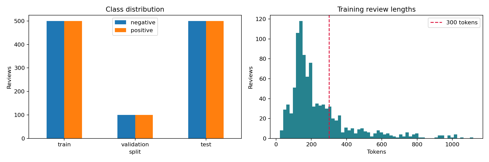
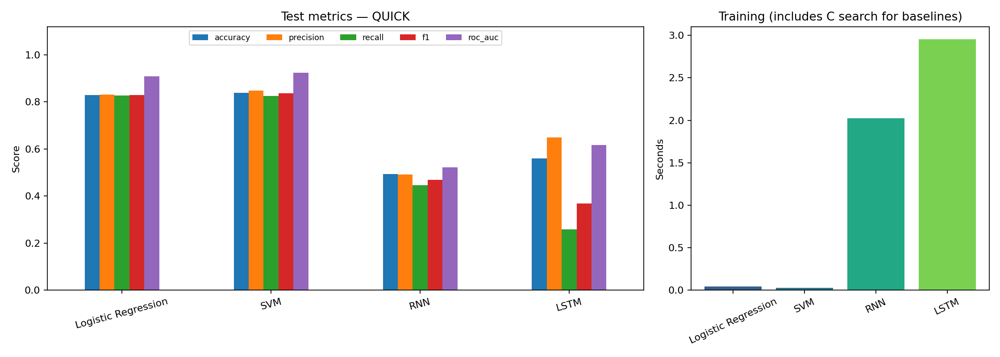
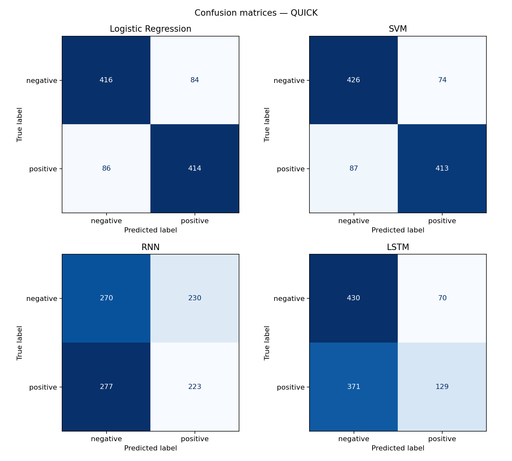
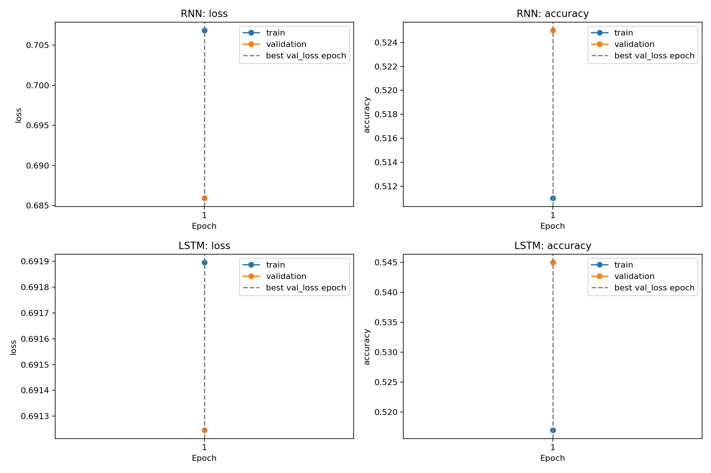

> **KIỂM TRA NHANH: 1.000 train / 200 validation / 1.000 test, 1 epoch. Không dùng bảng này để kết luận cho thí nghiệm đầy đủ. Mục thiết kế bên dưới mô tả cấu hình full.**

# Phân tích cảm xúc IMDB bằng RNN và LSTM

## 1. Mục tiêu và dữ liệu

Phân loại một đánh giá phim tiếng Anh thành negative (0) hoặc positive (1),
so sánh SimpleRNN, LSTM với hai phương pháp truyền thống Logistic Regression
và SVM tuyến tính. Các mô hình được huấn luyện lại trên cùng cách chia dữ liệu.

IMDB Large Movie Review Dataset gồm 50.000 đánh giá có nhãn, cân bằng hai lớp.
Giữ nguyên 25.000 mẫu test chính thức; tách phân tầng 25.000 mẫu train thành
20.000 train và 5.000 validation với seed 42. Không dùng 50.000 mẫu không nhãn.
Ưu tiên tải bản văn bản gốc Stanford; nếu máy chủ không truy cập được, dùng
bản Parquet từ kho `stanfordnlp/imdb`, giữ hai split train/test có sẵn.
CSV không có thông tin split trong thư mục `archive/` không được dùng để tự
chia lại test. ID trong bản Parquet là ID dòng của nguồn, không phải ID phim.

## 2. Cơ sở lý thuyết

### TF-IDF, Logistic Regression và SVM

TF-IDF kết hợp tần suất từ trong tài liệu với độ hiếm trong tập train.
Với `sublinear_tf=True`, TF của từ xuất hiện được biến đổi thành
$1+\log(tf)$. IDF mặc định có làm trơn:
$\mathrm{idf}(t)=\log((1+N)/(1+df(t)))+1$; vector được chuẩn hóa L2.
Unigram biểu diễn từng từ, bigram biểu diễn cặp như “not good”. Cách biểu diễn
này không mô hình hóa đầy đủ thứ tự câu nhưng thường là baseline mạnh.

Logistic Regression dự đoán $p(y=1|x)=\sigma(w^Tx+b)$, tối ưu log loss với
regularization L2. Linear SVM tìm biên phân tách có margin lớn; `LinearSVC`
dùng squared hinge loss và regularization L2 mặc định. Tham số $C$ điều khiển
mức phạt lỗi: $C$ lớn tương ứng regularization yếu hơn. Điểm `decision_function`
của SVM là khoảng cách có dấu tương đối, **không phải xác suất**.

### RNN

Với embedding $x_t$, RNN cập nhật trạng thái:

$$h_t=\tanh(W_xx_t+W_hh_{t-1}+b_h),\qquad
\hat y=\sigma(w_o^Th_T+b_o).$$

Trạng thái cuối tổng hợp thông tin theo thứ tự từ. Khi lan truyền ngược qua
nhiều bước thời gian, tích nhiều đạo hàm có thể làm gradient tiêu biến hoặc
bùng nổ. RNN vì vậy khó giữ thông tin ở đầu một đánh giá dài. Gradient clipping
giúp kiểm soát gradient bùng nổ, không giải quyết hoàn toàn gradient tiêu biến.

### LSTM

LSTM bổ sung trạng thái ô nhớ $c_t$ và ba cổng:

$$f_t=\sigma(W_f[x_t,h_{t-1}]+b_f),\quad
i_t=\sigma(W_i[x_t,h_{t-1}]+b_i),$$
$$\tilde c_t=\tanh(W_c[x_t,h_{t-1}]+b_c),\quad
c_t=f_t\odot c_{t-1}+i_t\odot\tilde c_t,$$
$$o_t=\sigma(W_o[x_t,h_{t-1}]+b_o),\quad
h_t=o_t\odot\tanh(c_t).$$

Cổng quên chọn thông tin giữ lại, cổng vào chọn thông tin mới, cổng ra điều khiển
trạng thái ẩn. Đường cập nhật cộng của ô nhớ hỗ trợ truyền thông tin xa hơn.
LSTM có nhiều tham số hơn SimpleRNN cùng số units; kết quả thực tế còn phụ thuộc
dữ liệu, regularization và ngân sách huấn luyện, không bảo đảm luôn tốt hơn.

## 3. Thiết kế thí nghiệm

- Làm sạch HTML, giải mã HTML entities, chuyển chữ thường, mở rộng phủ định
  như “isn't” → “is not”, thay dấu câu bằng khoảng trắng. Không bỏ stopword.
- Chỉ `fit` TF-IDF và `adapt` từ vựng trên train. Validation và test chỉ transform.
- Baseline: TF-IDF unigram/bigram, tối đa 20.000 đặc trưng, `min_df=2`,
  `sublinear_tf=True`. Logistic Regression và LinearSVC thử $C\in\{0.1,1,10\}$;
  chọn F1 validation cao nhất, hòa thì chọn C nhỏ hơn. Không refit trên train+val.
- Mạng: Embedding 128 → SimpleRNN/LSTM 64 → Dropout 0,5 → Dense sigmoid.
  Từ vựng chung tối đa 20.000 token (gồm padding/OOV), chuỗi 300 token,
  cắt phần cuối, padding cuối, `mask_zero=True`. Embedding học từ đầu.
- Adam learning rate 0,001, `clipnorm=1.0`, binary cross-entropy, batch 128,
  tối đa 10 epoch. Early stopping theo validation loss, patience 2,
  khôi phục trọng số tốt nhất. Hai mạng đặt lại cùng seed 42 trước khi tạo.
- LSTM dùng tanh/sigmoid, `recurrent_dropout=0`, không unroll, có bias và
  padding cuối để tương thích cuDNN khi GPU/runtime hỗ trợ.
- Dùng Accuracy, Precision, Recall, F1 (positive là lớp 1), ROC-AUC và confusion
  matrix. Ngưỡng dự đoán là 0,5 cho sigmoid/Logistic Regression, 0 cho SVM.
  ROC-AUC dùng xác suất hoặc margin của SVM, không dùng nhãn cứng.
- Chỉ tính kết quả test sau khi chọn C và trọng số mạng bằng validation.
  Theo dõi loss/accuracy train và validation để thảo luận overfitting.

TF-IDF dùng toàn bộ đánh giá, mạng chỉ dùng 300 token đầu. Đây là so sánh các
pipeline thực tế, chưa cô lập riêng ảnh hưởng của kiến trúc. Thời gian fit không
gồm tiền xử lý và đánh giá; baseline cộng thời gian cả ba giá trị C, mạng cộng
các epoch đã chạy. Thời gian tạo đặc trưng được ghi riêng. Baseline chạy CPU;
mạng dùng GPU khi có. So sánh thời gian phụ thuộc phần cứng, không chứng minh
một thuật toán có độ phức tạp thấp hơn. Một seed chưa đo được độ biến thiên
giữa các lần chạy và không đủ để khẳng định ý nghĩa thống kê.

## 4. Kết quả thực nghiệm

Lần chạy: **QUICK**. Nguồn: stanfordnlp/imdb Parquet (official splits). Thời điểm UTC: 2026-10-27T15:35:02.032021+00:00.

### 4.1. Dữ liệu thực tế và tài nguyên

| split | samples | negative | positive | mean_tokens | p95_tokens | truncated_fraction |
| --- | --- | --- | --- | --- | --- | --- |
| train | 1000 | 500 | 500 | 241.6220 | 632.2000 | 0.2330 |
| validation | 200 | 100 | 100 | 239.6750 | 588.1500 | 0.2400 |
| test | 1000 | 500 | 500 | 242.7200 | 579.3000 | 0.2530 |

CPU: Intel64 Family 6 Model 197 Stepping 2, GenuineIntel; GPU: không có. Baseline: CPU; mạng: CPU. Vocabulary: 17705; TF-IDF: 20000 đặc trưng.

### 4.2. Chọn cấu hình bằng validation

| model | C | validation_f1 | fit_seconds | run_mode |
| --- | --- | --- | --- | --- |
| Logistic Regression | 0.1000 | 0.7980 | 0.0124 | quick |
| Logistic Regression | 1.0000 | 0.8426 | 0.0108 | quick |
| Logistic Regression | 10.0000 | 0.8410 | 0.0190 | quick |
| SVM | 0.1000 | 0.8426 | 0.0092 | quick |
| SVM | 1.0000 | 0.8497 | 0.0088 | quick |
| SVM | 10.0000 | 0.8454 | 0.0120 | quick |

| model | C | validation_f1 | train_seconds | selected_fit_seconds | device | epochs_run | best_epoch | best_validation_loss | best_validation_accuracy | parameters |
| --- | --- | --- | --- | --- | --- | --- | --- | --- | --- | --- |
| Logistic Regression | 1.0000 | 0.8426 | 0.0422 | 0.0108 | CPU |  |  |  |  |  |
| SVM | 1.0000 | 0.8497 | 0.0299 | 0.0088 | CPU |  |  |  |  |  |
| RNN |  |  | 2.0262 |  | CPU | 1.0000 | 1.0000 | 0.6859 | 0.5250 | 2278657.0000 |
| LSTM |  |  | 2.9546 |  | CPU | 1.0000 | 1.0000 | 0.6912 | 0.5450 | 2315713.0000 |

### 4.3. So sánh trên cùng tập test

| model | run_mode | test_samples | accuracy | precision | recall | f1 | roc_auc | train_seconds | predict_seconds | device |
| --- | --- | --- | --- | --- | --- | --- | --- | --- | --- | --- |
| Logistic Regression | quick | 1000 | 0.8300 | 0.8313 | 0.8280 | 0.8297 | 0.9094 | 0.0422 | 0.0010 | CPU |
| SVM | quick | 1000 | 0.8390 | 0.8480 | 0.8260 | 0.8369 | 0.9247 | 0.0299 | 0.0008 | CPU |
| RNN | quick | 1000 | 0.4930 | 0.4923 | 0.4460 | 0.4680 | 0.5220 | 2.0262 | 0.3788 | CPU |
| LSTM | quick | 1000 | 0.5590 | 0.6482 | 0.2580 | 0.3691 | 0.6163 | 2.9546 | 0.6020 | CPU |

Thời gian tạo đặc trưng (tách khỏi thời gian fit):

TF-IDF fit: 0.412s; vocabulary adapt: 0.073s.

| split | tfidf_transform_seconds | sequence_transform_seconds |
| --- | --- | --- |
| train | 0.1591 | 0.0553 |
| validation | 0.0352 | 0.0162 |
| test | 0.1716 | 0.0518 |

### 4.4. Học theo epoch và overfitting

- RNN: đã chạy 1 epoch, chọn epoch 1; train accuracy − validation accuracy tại epoch chọn = -0.0140.
- LSTM: đã chạy 1 epoch, chọn epoch 1; train accuracy − validation accuracy tại epoch chọn = -0.0280.

Khoảng cách train/validation và xu hướng validation loss là dấu hiệu cần xem xét cùng nhau. Validation loss tăng trong khi train loss giảm có thể gợi ý overfitting. Một epoch trong quick chưa đủ đánh giá xu hướng.

### 4.5. Phân tích lỗi

| model | length_group | samples | error_rate |
| --- | --- | --- | --- |
| Logistic Regression | <=300 | 747 | 0.1754 |
| Logistic Regression | >300 | 253 | 0.1542 |
| SVM | <=300 | 747 | 0.1647 |
| SVM | >300 | 253 | 0.1502 |
| RNN | <=300 | 747 | 0.5060 |
| RNN | >300 | 253 | 0.5099 |
| LSTM | <=300 | 747 | 0.4458 |
| LSTM | >300 | 253 | 0.4269 |

Bảng theo độ dài mô tả tương quan; độ khó nội dung và độ dài cùng thay đổi nên không thể kết luận việc cắt chuỗi là nguyên nhân duy nhất. Các ví dụ sau được chọn tự động từ những dự đoán sai xa ngưỡng nhất. `has_negation` chỉ đánh dấu có not/no/never, không xác định phạm vi phủ định.

**Logistic Regression — test/10078:** nhãn thật 0, dự đoán 1, điểm 0.6841, 83 token, có phủ định: True.

> New York family is the last in their neighborhood to get a television set, which nearly ruins David Niven&#x27;s marriage to Mitzi Gaynor. Bedroom comedy that rarely ventures into the bedroom(and nothing sexy happens there anyway). Gaynor as an actress has about as much range as an oven--she turns on, she turns off. Film&#x27;s sole compensation is a supporting performance by perky Patty Duke, pre-&quot;Miracle Worker&quot;, as Niven&#x27;s daughter. She&#x27;s delightful; &quot;Happy Anniversary&quot; is not. * from ****

**Logistic Regression — test/09115:** nhãn thật 0, dự đoán 1, điểm 0.6764, 198 token, có phủ định: False.

> In the aftermath of September 11th in New York, this drama about American firefighters was conceived as a salute and tribute to their professionalism. The story is told with a series of flashbacks, where after firefighter Jack Morrison (Joaquin Phoenix) has crashed through the floor of a burning building, and only communicating with Captain Mike Kennedy (John Travolta) via the radio. The flashbacks basically show how Jack grows from being a recruit, seeing Kennedy as a father figure, to being a 

**Logistic Regression — test/05331:** nhãn thật 0, dự đoán 1, điểm 0.6479, 96 token, có phủ định: True.

> I enjoyed the beautiful scenery in this movie the first time I saw it when I was 9 . Dunderklumpen is kind of cute for kiddies in a corny way. It reminded me of HRPUFFINSTUFF on sat mornings, Its Swedish backdrops make it easy on the eyes . Don&#x27;t expect older kids to be interested as the live action/animation is way behind the times and most older kids will get bored.This is definitely an under 10 age set movie and a nice bit of memories for those of us who were little kids in 1974.

**SVM — test/10078:** nhãn thật 0, dự đoán 1, điểm 0.7160, 83 token, có phủ định: True.

> New York family is the last in their neighborhood to get a television set, which nearly ruins David Niven&#x27;s marriage to Mitzi Gaynor. Bedroom comedy that rarely ventures into the bedroom(and nothing sexy happens there anyway). Gaynor as an actress has about as much range as an oven--she turns on, she turns off. Film&#x27;s sole compensation is a supporting performance by perky Patty Duke, pre-&quot;Miracle Worker&quot;, as Niven&#x27;s daughter. She&#x27;s delightful; &quot;Happy Anniversary&quot; is not. * from ****

**SVM — test/09115:** nhãn thật 0, dự đoán 1, điểm 0.6681, 198 token, có phủ định: False.

> In the aftermath of September 11th in New York, this drama about American firefighters was conceived as a salute and tribute to their professionalism. The story is told with a series of flashbacks, where after firefighter Jack Morrison (Joaquin Phoenix) has crashed through the floor of a burning building, and only communicating with Captain Mike Kennedy (John Travolta) via the radio. The flashbacks basically show how Jack grows from being a recruit, seeing Kennedy as a father figure, to being a 

**SVM — test/05331:** nhãn thật 0, dự đoán 1, điểm 0.6654, 96 token, có phủ định: True.

> I enjoyed the beautiful scenery in this movie the first time I saw it when I was 9 . Dunderklumpen is kind of cute for kiddies in a corny way. It reminded me of HRPUFFINSTUFF on sat mornings, Its Swedish backdrops make it easy on the eyes . Don&#x27;t expect older kids to be interested as the live action/animation is way behind the times and most older kids will get bored.This is definitely an under 10 age set movie and a nice bit of memories for those of us who were little kids in 1974.

**RNN — test/14789:** nhãn thật 1, dự đoán 0, điểm 0.3388, 91 token, có phủ định: True.

> Attend the tale of Sweeney Todd...The strangest, most off-putting, but most wonderful Broadway musical. It is chilling, funny, and moving all at once through Sondheim&#x27;s most memorable and incredible score and sharp performances. George Hearn is incomparable in the title role, bringing a strong voice and dead on (no pun intended) impersonation of the legendary demon barber, while Angela Lansbury provides the comic relief as she cheerfully grinds up his victims into meat pies. If you just allow yo

**RNN — test/19686:** nhãn thật 1, dự đoán 0, điểm 0.3464, 115 token, có phủ định: True.

> This mystery/psychological-thriller is I think one of the best I&#x27;ve ever seen. All the actors give a wonderful performance, especially Jennifer Rubin as Jamie Harris, who changes from the nervous starlet in the beginning through the strange events she is part of to the cool star. You learn a lot about the real inside emotions of people in this movie, and a lot about the movie business itself. The movie in movie situations in the beginning and through the game that is played with her by the &quot;acti

**RNN — test/22981:** nhãn thật 1, dự đoán 0, điểm 0.3509, 39 token, có phủ định: True.

> Antonioni with Wim Wenders --some of the best of the best. story-character-visuals. Like most of their works, it is not really aimed at the children or the childish. Don&#x27;t miss the genius contained in this one.

**LSTM — test/24033:** nhãn thật 1, dự đoán 0, điểm 0.4802, 135 token, có phủ định: True.

> yes barney is nonsense now but when i was a kid it made perfect sense.&lt;br /&gt;&lt;br /&gt;i haven&#x27;t gotten any smarter but i enjoyed it. as a child i was mocked because no one could say my name so i changed it. ever since i was 4 I&#x27;ve gone by the name Tina from barney because i could relate to her being from a different culture. i&#x27;m 17 now and barney is a huge part of my life . ...my name came from it.... i cant dis the show i grew up with no matter how stupid it seems now.&lt;br /&gt;&lt;br /&gt;i don&#x27;t care if i 

**LSTM — test/16211:** nhãn thật 1, dự đoán 0, điểm 0.4806, 56 token, có phủ định: False.

> Words can hardly describe what Blue Planet brought to life in all of its hours of runtime. Matching up with Walking With Dinosaurs, this documentary stands as one of the best. We can only pray that the BBC and Discovery Channel come up with even more outstanding ideas that could possibly even level with this one.

**LSTM — test/19714:** nhãn thật 1, dự đoán 0, điểm 0.4813, 354 token, có phủ định: True.

> So it might not be entirely historically accurate. And there is little or no real character development. But for Jake (son of Ridley) Scott&#x27;s first attempt, it&#x27;s well worth the ticket price.&lt;br /&gt;&lt;br /&gt;Captain James MaCleane (Jonny Lee Miller looking as good as ever) may be a gentleman, but he hasn&#x27;t got the money or the clothes to prove it. Plunkett (Robert Carlyle with all his clothes on) is an apothecary-turned-outlaw. The circumstances of their strange meeting involve a dead body, a ruby, an

Để diễn giải từng lỗi, đọc cả đánh giá gốc trong `error_examples.csv`: phủ định có thể đảo nghĩa của từ tích cực; mỉa mai hoặc cảm xúc trái chiều đòi hỏi ngữ cảnh; phần kết luận sau token 300 bị mạng bỏ qua. Các cơ chế này là hướng kiểm tra, chưa phải nguyên nhân đã được xác nhận cho mọi ví dụ. TF-IDF có thể học bigram nhưng thiếu phụ thuộc dài; RNN có thể mất tín hiệu xa; LSTM có thể vẫn overfit khi học embedding từ đầu.

## 5. Nhận xét và kết luận

Pipeline đã chạy đủ bốn mô hình và xuất bảng/hình/mô hình. Cỡ mẫu nhỏ và một epoch chỉ phục vụ kiểm tra kỹ thuật; cần chạy FULL trên Colab GPU để kết luận bài tập.

## 6. Khả năng tái lập

Cấu hình đầy đủ ở `config.json`; phần cứng, phiên bản, URL và SHA-256 dữ liệu ở `environment.json`; ID và nhãn từng split ở `split_manifest.csv`. `checks.json` ghi các kiểm tra đã vượt qua. Đã đặt seed và deterministic ops; kết quả vẫn có thể khác giữa phiên bản thư viện hoặc phần cứng.

## Tài liệu tham khảo

1. Maas et al. (2011), *Learning Word Vectors for Sentiment Analysis*, ACL.
   [Bài báo](https://aclanthology.org/P11-1015/),
   [dữ liệu Stanford](https://ai.stanford.edu/~amaas/data/sentiment/).
2. [Bản dữ liệu Stanford NLP trên Hugging Face](https://huggingface.co/datasets/stanfordnlp/imdb).
3. [Keras: Text classification from scratch](https://keras.io/examples/nlp/text_classification_from_scratch/).
4. [Keras SimpleRNN](https://keras.io/api/layers/recurrent_layers/simple_rnn/),
   [Keras LSTM](https://keras.io/api/layers/recurrent_layers/lstm/).
5. [scikit-learn LogisticRegression](https://scikit-learn.org/stable/modules/generated/sklearn.linear_model.LogisticRegression.html),
   [LinearSVC](https://scikit-learn.org/stable/modules/generated/sklearn.svm.LinearSVC.html),
   [TfidfVectorizer](https://scikit-learn.org/stable/modules/generated/sklearn.feature_extraction.text.TfidfVectorizer.html).
